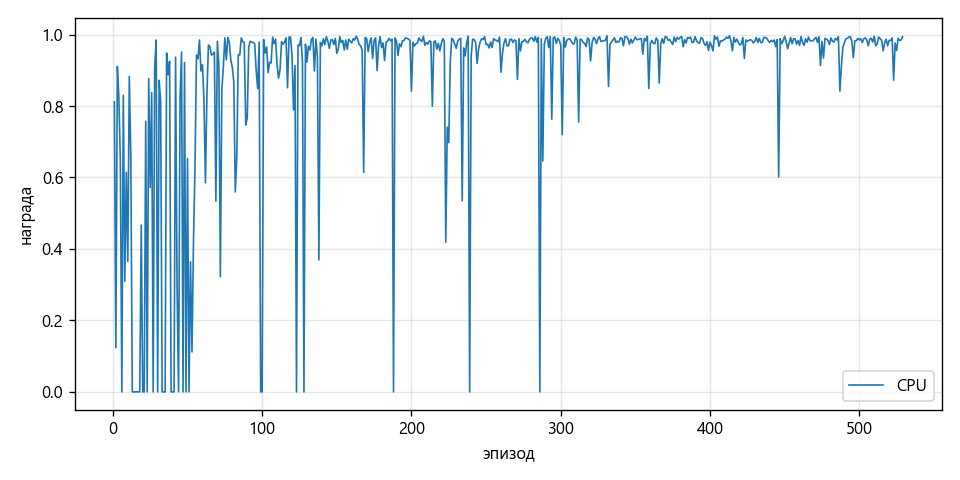
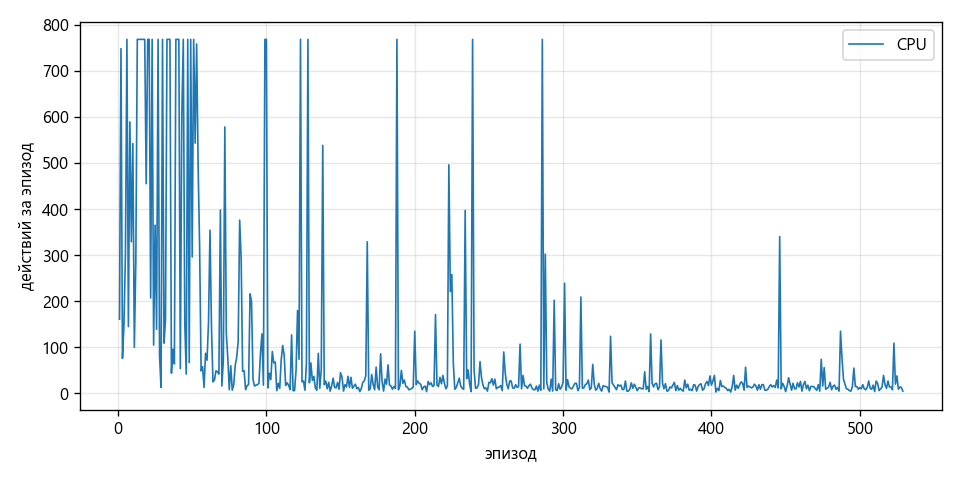
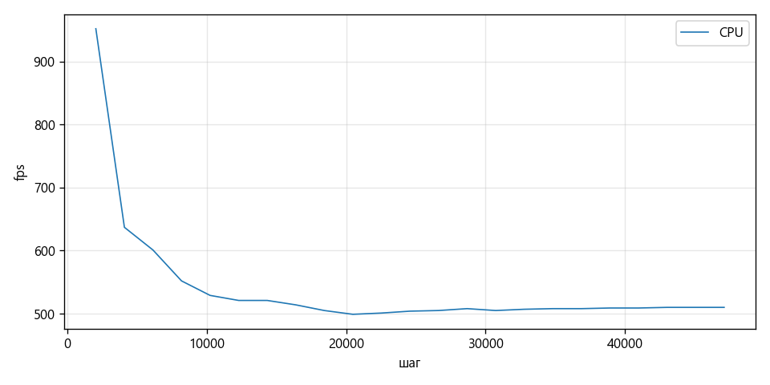
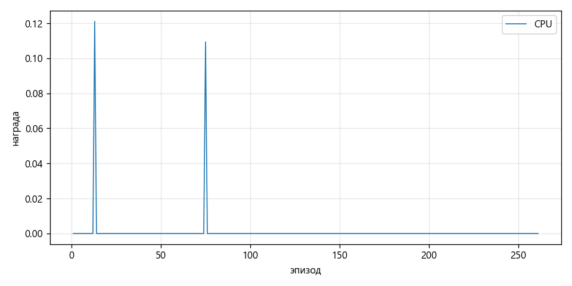
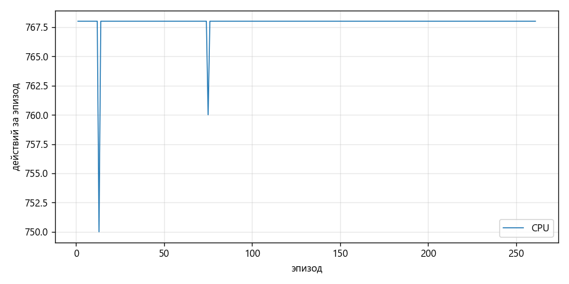
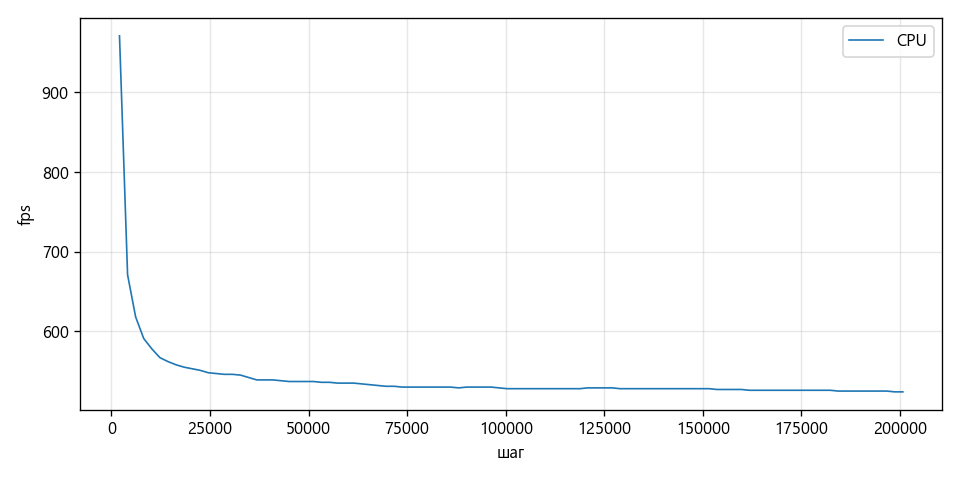
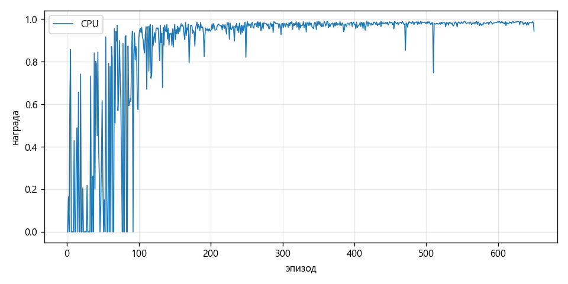
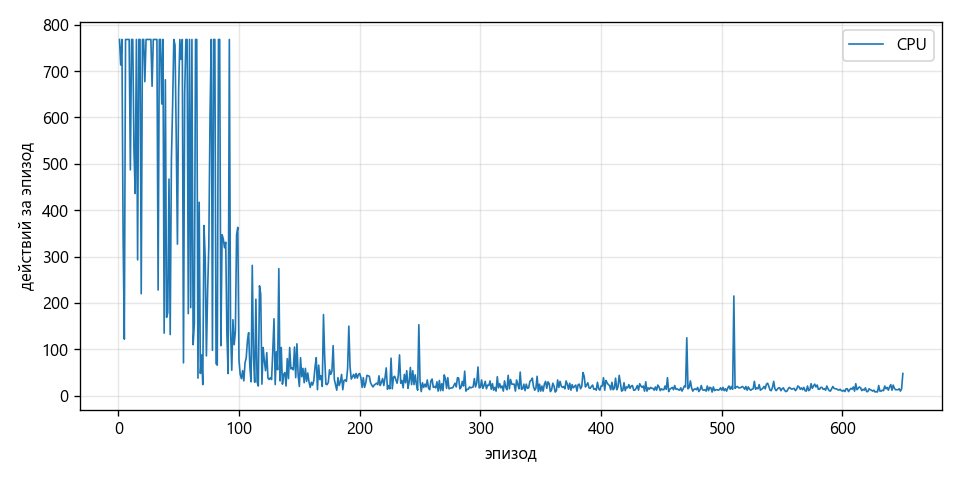
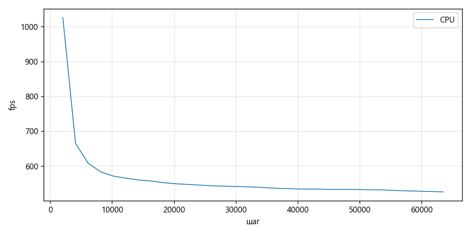

# desktop ver0

Машина: desktop. Seed: 42. Версия: 0.
Лимит шагов эпизода: 768. Бюджет шагов: 200000. Остановка, если награда не выросла больше чем на 0.02 за 500 эпизодов.
Успех: не меньше 7 из последних 10 эпизодов. В таблице время до этой остановки, в секундах.

## Время и успех

| Карта | CPU, с | CPU, цели | CUDA, с | CUDA, цели |
| --- | ---: | --- | ---: | --- |
| MiniGrid-MultiRoom-N2-S4-v0 | 95.0 | 10/10 | — | ошибка |
| MiniGrid-KeyCorridorS3R3-v0 | 384.4 | 0/10 | — | ошибка |
| MiniGrid-DoorKey-5x5-v0 | 124.2 | 10/10 | — | ошибка |

## Карты

### MiniGrid-MultiRoom-N2-S4-v0

Снимок карты не найден.

Награда по эпизодам, без сглаживания.

Длина эпизода в действиях.

Скорость обучения, кадров среды в секунду.

### MiniGrid-KeyCorridorS3R3-v0

Снимок карты не найден.

Награда по эпизодам, без сглаживания.

Длина эпизода в действиях.

Скорость обучения, кадров среды в секунду.

### MiniGrid-DoorKey-5x5-v0

Снимок карты не найден.

Награда по эпизодам, без сглаживания.

Длина эпизода в действиях.

Скорость обучения, кадров среды в секунду.
